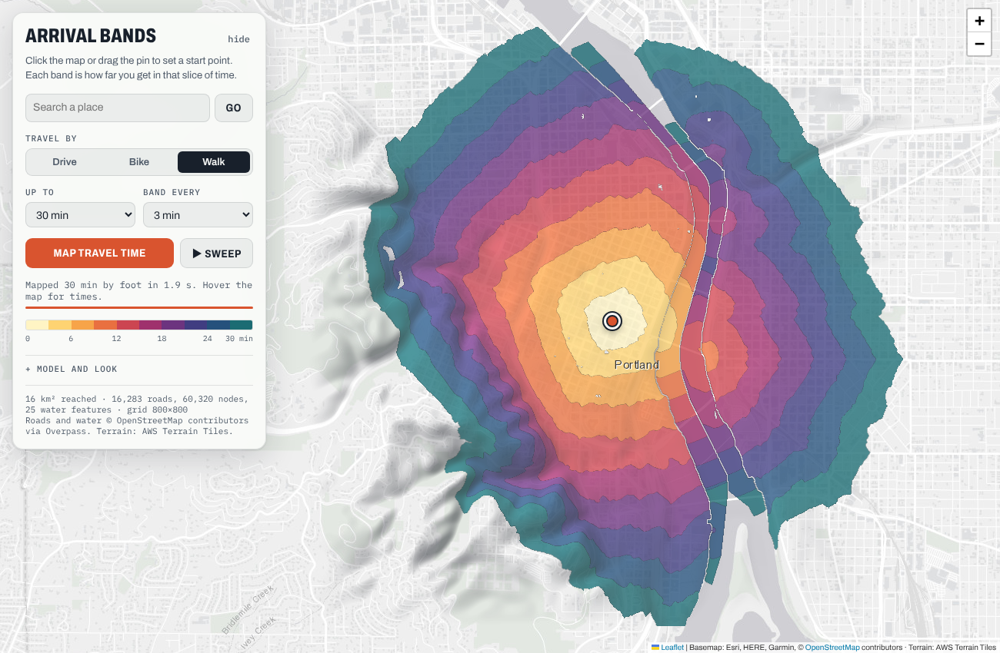

# Arrival Bands

Travel-time maps from any start point, drawn as stepped color bands. Bands stretch along highways, pinch at
river crossings and bunch up on slopes.

## Use it

Open `index.html` in a browser (double-click works, or serve the folder). No build or API key is needed.
Click the map or drag the pin to pick a start point. Choose Drive, Bike or Walk, a time limit and the band width.
**Sweep** animates the arrival front outward. Your settings live in the URL hash, so a link reopens the same map.

## How it works

1. **Data.** One Overpass API query downloads the road network for the area you could possibly reach, plus rivers,
   canals, lakes and coastline. The road detail scales with distance (every street for short trips, major roads for long drives).
   Terrain comes from the AWS Terrain Tiles (Terrarium) elevation tiles.
2. **Roads.** Speeds come from the road class, or from `maxspeed` when tagged. Winding roads are slowed, intersections add
   a few seconds, `oneway` is respected, and ferries add a boarding wait. Bikes and walkers slow down on uphill grades
   (Tobler's hiking function for walking).
3. **Off-network ground.** The area is a grid. One Dijkstra search runs over the road nodes and the grid cells together,
   so you can walk off a road, across a field and onto another road. You can leave a road anywhere along it, except
   motorways (only at exits), bridges, tunnels and ferries. Water cells block movement, so rivers are crossed only on bridges.
   Off-network speed and the off-network time limit are adjustable.
4. **Rendering.** The time field is upsampled, cut into bands, outlined, shaded with hillshade and drawn as a canvas
   overlay in Leaflet.

## Limits

- Public Overpass servers rate-limit heavy use. Two-hour drives download a lot of data and can time out, so use a
  shorter time or "Major roads only" if that happens.
- Speeds are free-flow estimates: no traffic, signals timing or turn restrictions.
- Data © OpenStreetMap contributors (ODbL). Basemap © Esri, HERE, Garmin, OpenStreetMap contributors.
